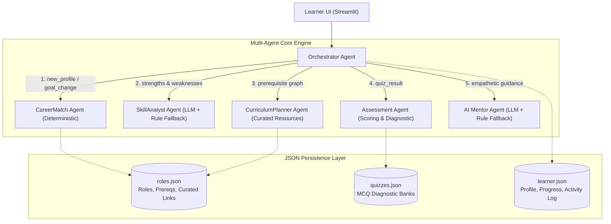

# SkillForge AI | Personalized Adaptive Learning Platform

> Built for the **PromptWars Hackathon** — An AI-orchestrated career preparation and adaptive curriculum platform.

---

## 📌 Problem Statement
Universities and organizations struggle to diagnose individual learner skill gaps relative to dynamic career expectations. Traditional e-learning platforms broadcast monolithic, one-size-fits-all course tracks. **SkillForge AI** replaces static catalogs with a collaborative multi-agent architecture that:
1. Performs deterministic skill gap analysis and calculates a readiness score.
2. Synthesizes personalized learning roadmaps using verified, curated educational resources (MDN, freeCodeCamp, official docs).
3. Continuously tracks progress and dynamically adapts to assessment outcomes and target role pivots.

---

## 🏛️ System Architecture



---

## 🤖 Multi-Agent Roster

| Agent Name | Primary Responsibility | Engine Type | Deterministic / Fallback Guarantee |
| :--- | :--- | :--- | :--- |
| **Orchestrator** | Event dispatcher & pipeline coordinator (`new_profile`, `quiz_result`, `goal_change`) | Deterministic Router | State machine with real-time activity logging |
| **CareerMatch** | Evaluates skills vs role requirements; calculates readiness score % and gaps | Deterministic Algorithm | Exact match + normalized alias matching |
| **SkillAnalyst** | Evaluates learner background and identifies key strengths and growth areas | Gemini LLM | Concise rule-based summary fallback |
| **CurriculumPlanner**| Sequences missing skills by prerequisites and assigns verified resources | Deterministic Graph | Fixed curated URLs (MDN, freeCodeCamp, Kaggle) |
| **Assessment** | Evaluates quiz submissions, calculates scores %, and flags revision needs | Deterministic Evaluator | Validated answer key with instant feedback |
| **AI Mentor** | Explains curriculum adaptations and offers empathetic guidance | Gemini LLM | Contextual templated advice fallback |

---

## 🚀 Setup & Installation

### Prerequisites
- Python 3.10+ (tested on Python 3.10–3.14)
- Git

### 1. Clone & Enter Project Directory
```bash
git clone <repo-url>
cd learning-platform
```

### 2. Set Up Virtual Environment
```bash
python -m venv .venv
# Windows (PowerShell):
.\.venv\Scripts\Activate.ps1
# macOS/Linux:
source .venv/bin/activate
```

### 3. Install Dependencies
```bash
pip install -r requirements.txt
```

### 4. Configure Environment Variables (Optional)
Create a `.env` file in the `learning-platform` directory:
```bash
cp .env.example .env
```
Inside `.env`:
```env
GEMINI_API_KEY=your_gemini_api_key_here
```
> **Note:** If no API key is provided, the platform automatically activates its **graceful rule-based fallback mode**. The app runs with 100% functionality even without an API key!

---

## 🖥️ How to Run

From the `learning-platform` folder:
```bash
streamlit run app.py
```
Or from the project root:
```bash
streamlit run learning-platform/app.py
```

---

## 🎬 Default Demo Walkthrough (Sample Scenario)

1. **Load Default Demo**: Click **"📥 Load Demo Scenario (PromptWars)"** in the sidebar.
   - Pre-fills learner **Alex Chen** with skills `Python`, `SQL`, `HTML & CSS` targeting **Full Stack Developer**.
2. **Review Analysis**:
   - Matched skills: `HTML & CSS`, `Python`, `SQL`
   - Missing skills: `JavaScript`, `React`, `Node.js`
   - Readiness score: **50.0%**
3. **Inspect Live Agent Activity**:
   - Observe the sidebar trace demonstrating `CareerMatch`, `SkillAnalyst`, `CurriculumPlanner`, and `Mentor` executing in sequence.
4. **Adaptive Goal Switch**:
   - Switch target role to **Data Scientist** in the sidebar to observe `goal_change` dynamically re-calculating gaps and rebuilding the path.
