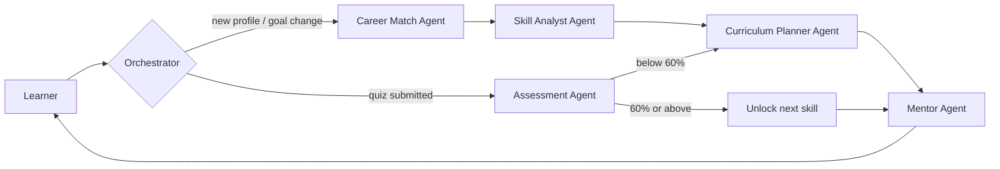

<div align="center">

# 🌱 GrowPath

### Your personal learning coach, powered by a team of AI agents

GrowPath finds your skill gaps, builds a learning path for your dream job,<br>
and re-plans the moment you struggle or change your goal.


[Live Demo](#) · [Features](#-features) · [How It Works](#-how-it-works) · [Run Locally](#-run-locally)

</div>

---

## The Problem

Organizations and universities struggle to see which skills their people lack for a career goal. Traditional learning platforms give everyone the same courses, ignoring what the learner already knows, how they are progressing, and where they want to go.

## Our Solution

GrowPath is a multi-agent learning platform. You tell it who you are, what you know, and your dream job. A team of specialized AI agents then works together to:

1. **Find the gaps** between your skills and the target role
2. **Build a personal learning path**, ordered by prerequisites
3. **Test you** with short quizzes after each skill
4. **Adapt instantly** when you fail a quiz or change your goal
5. **Coach you** with a clear progress report and next step

---

## ✨ Features

| | Feature | What you get |
|---|---|---|
| 🧑‍💼 | **Guided profile** | Enter your name, skills and dream job. Skills are matched even if typed differently ("javascript" = "JavaScript"). |
| 📊 | **Skill Gap** | A readiness score, skills you have, skills you need, and a plain-English explanation of why each missing skill matters. |
| 📚 | **Course** | For every skill: what to learn, practice links, YouTube video suggestions, and a "Mark as done" button. |
| 🧠 | **Skill quiz** | Five challenging scenario-based questions per skill, with correct answers and explanations after you submit. |
| 🔁 | **Adaptive re-planning** | Score below 60% and a revision step is added. Pass and the next skill unlocks. Change your goal and the whole plan rebuilds. |
| 🎯 | **Mentor** | Summary cards, charts of your scores and progress, your next step, and a short personal note. |
| 🔍 | **Transparent agents** | A "See how your AI team worked" panel shows which agent did what. |

---

## 🤖 How It Works

Every action (new profile, quiz result, goal change) is an **event** that the Orchestrator routes to the right agents.



### The agent team

| Agent | Job |
|---|---|
| **Orchestrator** | Receives each event and calls the other agents in the right order |
| **Career Match** | Compares your skills with the target role and finds the gaps and readiness % |
| **Skill Analyst** | Summarizes your strengths and weaknesses |
| **Curriculum Planner** | Builds the ordered learning path and adds revision steps after a low score |
| **Assessment** | Serves quiz questions and scores your answers |
| **Mentor** | Explains feedback and plan changes in plain language |

**Design choice:** the AI writes explanations, questions and notes. Plain code handles gap matching, ordering and scoring, so results stay predictable. Every AI feature has an offline fallback, so the app keeps working even if the API is unavailable.

---

## 🆚 How GrowPath Is Different

| | Typical enterprise platforms | GrowPath |
|---|---|---|
| **Built for** | HR and L&D teams | The individual learner, including students |
| **Architecture** | One recommendation engine | A team of specialized, collaborating agents |
| **Transparency** | Black box | Visible agent activity |
| **Adaptation** | Re-ranks content over time | Re-plans immediately after a failed quiz or goal change |
| **Explanations** | Little reasoning shown | The Mentor explains every plan change |

---

## 🖼️ Screenshots

<!-- Add your images to a /screenshots folder, then uncomment: -->
<!--
| Details | Skill Gap |
|---|---|
|  |  |

| Course | Mentor |
|---|---|
|  |  |
-->

---

## 🚀 Run Locally

**1. Clone the repo**

```bash
git clone https://github.com/Honzo007/skillpath-ai.git
cd skillpath-ai
```

**2. Install dependencies**

```bash
pip install -r requirements.txt
```

**3. Add your Gemini API key**

Create a file named `.env` in the project folder:

```
GEMINI_API_KEY=your_key_here
```

Get a free key at [Google AI Studio](https://aistudio.google.com). Without a key the app still runs in offline mode with basic tips.

**4. Start the app**

```bash
python -m streamlit run app.py
```

Open [http://localhost:8501](http://localhost:8501).

---

## 🎬 Quick Demo Script

1. Enter a name, choose **Full Stack Developer**, and add the skills **Python, SQL, HTML**.
2. On **Skill Gap**, see your readiness score and the missing skills (JavaScript, React, Node.js).
3. Open **Course**, learn the first skill, click **Mark as done**, and take the quiz.
4. **Fail on purpose.** A revision step is added and the Mentor explains why.
5. Click **Edit profile / change goal**, switch to **Data Scientist**, and watch the plan rebuild.
6. Open **Mentor** for your charts, next step, and personal note.

---

## 🧰 Tech Stack

- **Python** and **Streamlit** for the app and UI
- **Google Gemini API** for explanations, quiz questions and mentor notes
- **JSON files** for role data, quizzes and learner progress (no database)
- **Rule-based fallbacks** for every AI-powered feature

## 📁 Project Structure

```
├── app.py                # Streamlit app (details, Skill Gap, Course, Mentor)
├── agents/               # Orchestrator and the specialized agents
├── data/                 # roles.json, quizzes.json, cached content
├── check_links.py        # Checks that learning links still work
├── requirements.txt
└── .env.example
```

## ⚠️ Limitations and Next Steps

This is a 4-hour hackathon prototype.

- A small set of career roles and curated resources (easy to extend in `data/roles.json`)
- Quizzes are multiple choice
- Progress is stored in local JSON files, not per-user accounts

**Next:** a final exam with practical tasks, user accounts, more roles, and live course integrations.

---

<div align="center">

Built for **PromptWars** · Made with 🌱 by [Honzo007](https://github.com/Honzo007)

</div>
